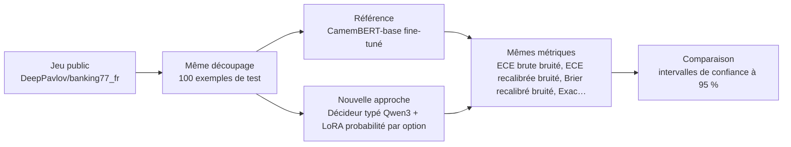
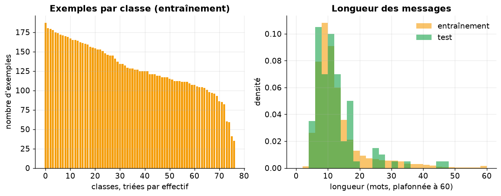
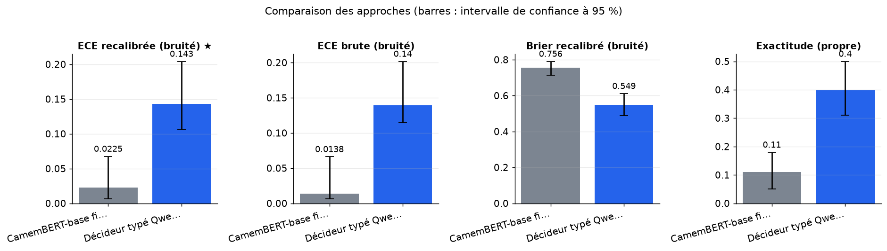
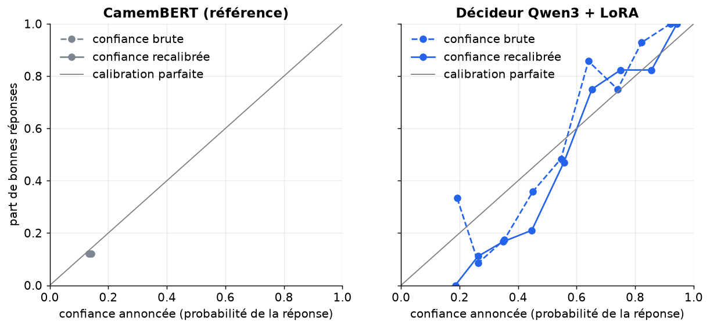
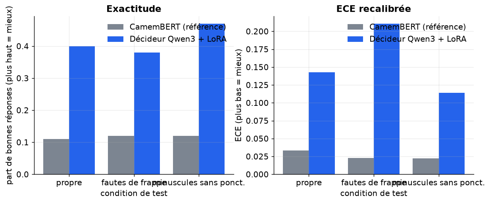

# Un décideur typé à probabilités par option est-il mieux calibré et plus robuste au bruit qu'un CamemBERT entièrement entraîné, avant et après recalibrage ?

> **En bref.** L'expérience ne permet pas de dire si le décideur typé est mieux calibré que CamemBERT. À cette échelle, la référence n'a presque rien appris, donc son ECE basse est triviale. Verdict non concluant. ECE recalibrée (bruité) : 0,143 [0,107 ; 0,204] pour Décideur typé Qwen3-0.6B + LoRA, contre 0,0225 [0,00667 ; 0,0676] pour CamemBERT-base fine-tuné (100 exemples de test, échelle réduite, chiffres indicatifs).

## Sommaire

1. [La question](#la-question)
2. [Le protocole](#le-protocole)
3. [Les résultats](#les-résultats)
4. [Ce qu'il faut retenir](#ce-quil-faut-retenir)
5. [Rejouer l'expérience](#rejouer-lexpérience)
6. [Contenu du dépôt](#contenu-du-dépôt)
7. [Références](#références)
8. [Glossaire](#glossaire)

## La question

Un modèle qui route des messages clients sans intervention humaine doit annoncer des confiances fiables : quand il dit « 90 % », il doit avoir raison environ 9 fois sur 10. L'expérience compare deux façons d'obtenir ces confiances sur des requêtes de services financiers en français, propres ou bruitées (fautes de frappe, texte en minuscules sans ponctuation). La première est un CamemBERT classique entraîné sur tout le jeu. La seconde est un petit LLM (Qwen3-0.6B adapté par LoRA) à qui l'on pose un QCM de 8 intentions candidates ; on lit directement la probabilité qu'il donne à chaque lettre. La comparaison dit si le décideur à QCM reste nettement mieux calibré sur texte bruité après recalibrage, sans perdre en exactitude.

**Hypothèse testée.** Après recalibrage par température sur 500 exemples, le décideur Qwen3-0.6B adapté par LoRA atteint une ECE sur texte bruité inférieure d'au moins 30 % relatif à celle d'un CamemBERT-base entraîné sur tout le jeu, sans perdre plus de 3 points d'exactitude sur texte propre.

| | Référence | Nouvelle approche |
|---|---|---|
| **Approche** | CamemBERT-base fine-tuné | Décideur typé Qwen3 + LoRA (probabilité par option) |
| **Principe** | Classifieur CamemBERT-base fine-tuné sur tout le train (hors lot de calibration), logits restreints aux mêmes candidats que le décideur pour une comparaison à périmètre égal. | Un petit LLM reçoit le texte et 8 options candidates lettrées et rend, en une passe, une distribution sur les lettres lue dans les logits du premier token, sans génération. Adapté par LoRA sur un sous-ensemble du train, puis recalibré. |
| **Mise en œuvre** | transformers AutoModelForSequenceClassification (77 classes), 3 époques, lr 3e-5, batch 32, fp16 ; softmax restreint aux K=8 candidats ; recalibrage par température ajustée sur le lot de calibration. | Candidats K=8 par similarité d'embeddings aux centroïdes de classes (rappel@8 rapporté) ; prompt à options lettrées, ordre mélangé à l'entraînement ; peft LoRA r=16 sur projections d'attention, 1 époque ; probabilité = softmax des logits des lettres A–H ; recalibrage par température ; perturbations : 10 % de fautes de frappe et minuscules sans ponctuation. |
| **Modèles** | [`almanach/camembert-base`](https://huggingface.co/almanach/camembert-base) | [`Qwen/Qwen3-0.6B`](https://huggingface.co/Qwen/Qwen3-0.6B), [`sentence-transformers/paraphrase-multilingual-MiniLM-L12-v2`](https://huggingface.co/sentence-transformers/paraphrase-multilingual-MiniLM-L12-v2) |

## Le protocole



- **Données** : [`DeepPavlov/banking77_fr`](https://huggingface.co/datasets/DeepPavlov/banking77_fr) (configuration `default`), évaluation sur le découpage `test` (100 exemples). Requêtes clients de services financiers en français, 77 intentions proches, assez de données pour entraîner correctement l'encodeur ; permet ECE, Brier, recalibrage et bruit contrôlé.
- **Écarts avec des données réelles** : Traduction automatique, messages courts et propres, 77 classes plates et équilibrées, pas de hiérarchie, licence de la traduction non précisée ; bruit simulé et non réel.
- **Déroulé** : Jeu public DeepPavlov/banking77_fr (77 intentions, requêtes clients en français) ; les noms de classes viennent de mteb/banking77. On tire 500 exemples du split train comme lot de calibration, exclu de tout entraînement. Le reste entraîne CamemBERT-base (3 époques, lr 3e-5, lots de 32, fp16) ; un sous-ensemble de 2000 exemples adapte Qwen3-0.6B par LoRA (r=16 sur les projections d'attention, 1 époque, entropie croisée sur les lettres A–H). Les deux approches sont jugées sur les mêmes 8 candidats, présélectionnés par similarité aux centroïdes d'embeddings MiniLM multilingues, et sur les mêmes 800 exemples du split test, dans trois conditions : propre, 10 % de fautes de frappe, minuscules sans ponctuation. La température est ajustée sur la calibration propre puis appliquée telle quelle. On mesure l'ECE (15 tranches), le Brier, l'exactitude, le macro-F1, la baisse sous bruit et le rappel@8, avec des IC bootstrap (1000 tirages), un bootstrap apparié de l'ECE et un test de McNemar.
- **Deux échelles, un seul code** : l'échelle réduite (100 exemples, CPU, 7 min) valide la mécanique ; l'échelle complète n'a pas été exécutée (exception (cellule 52, section new_approach)) : résultats indicatifs.



*À gauche, le nombre d'exemples d'entraînement par classe (une barre par classe) : une pente douce signale des classes à peu près équilibrées. À droite, la longueur des messages en mots, à l'entraînement et au test : des courbes proches signalent des parties comparables.*

**Les métriques**

| Métrique | Ce qu'elle mesure | Meilleur si |
|---|---|---|
| ECE brute (bruité) | Écart moyen entre la confiance annoncée et le taux réel de bonnes réponses sur texte bruité, avant recalibrage. | plus bas |
| ECE recalibrée (bruité) ★ | Le même écart, après une température ajustée sur des messages propres mis de côté ; c'est la métrique principale. | plus bas |
| Brier recalibré (bruité) | Erreur quadratique entre les probabilités des 8 options et la bonne réponse : il pénalise à la fois l'erreur et la mauvaise confiance. | plus bas |
| Exactitude (propre) | Part des messages propres dont l'intention retenue est la bonne. | plus haut |
| Macro-F1 (propre) | Moyenne du F1 de chaque classe sur texte propre : chaque intention compte autant, quel que soit son effectif. | plus haut |
| Baisse d'exactitude sous bruit | Exactitude sur texte propre moins exactitude moyenne sur texte bruité : plus elle est faible, plus le modèle est robuste. | plus bas |
| Rappel@8 des candidats | Part des messages dont la bonne intention figure parmi les 8 candidats présélectionnés : c'est le plafond commun aux deux approches. | plus haut |

★ métrique principale : c'est elle qui tranche la question.

## Les résultats

| Approche | ECE brute (bruité) ↓ | ECE recalibrée (bruité) ★ ↓ | Brier recalibré (bruité) ↓ | Exactitude (propre) ↑ | Macro-F1 (propre) ↑ | Baisse d'exactitude sous bruit ↓ | Rappel@8 des candidats ↑ | Latence médiane (ms) ↓ |
|---|---|---|---|---|---|---|---|---|
| CamemBERT-base fine-tuné (référence) | **0,0138 [0,00609 ; 0,0663]** | **0,0225 [0,00667 ; 0,0676]** | 0,756 [0,713 ; 0,791] | 0,11 [0,05 ; 0,18] | 0,0447 [0,0164 ; 0,0726] | -0,01 [-0,035 ; 0,015] | 0,85 [0,77 ; 0,92] | 55,7 |
| Décideur typé Qwen3-0.6B + LoRA (nouvelle approche) | 0,14 [0,114 ; 0,202] | 0,143 [0,107 ; 0,204] | **0,549 [0,488 ; 0,612]** | **0,4 [0,31 ; 0,5]** | **0,343 [0,231 ; 0,38]** | **-0,025 [-0,11 ; 0,065]** | 0,85 [0,77 ; 0,92] | 526 |

★ métrique principale · ↑ plus haut = meilleur · ↓ plus bas = meilleur · entre crochets : intervalle de confiance à 95 % (bootstrap) · en gras : la meilleure valeur.



*Valeur de chaque métrique par approche (★ : métrique principale, à minimiser) ; les barres d'erreur donnent l'intervalle de confiance à 95 % sur 100 exemples de test.*



*Diagramme de fiabilité sur texte bruité (fautes de frappe et minuscules regroupées). Un point sous la diagonale signale une surconfiance ; le trait plein montre l'effet de la température.*



*Exactitude (à gauche) et ECE après température (à droite) pour chaque condition de test. La température est ajustée sur du texte propre puis appliquée telle quelle au texte bruité.*

**Lecture** (confiance moyenne). À l'échelle réduite (100 messages de test, 96 exemples pour le décideur, 500 pour CamemBERT, CPU), les chiffres ne permettent pas de trancher. CamemBERT, entraîné une seule époque pour 77 classes, atteint 0,11 d'exactitude : son ECE recalibrée très basse (0,023, contre 0,143 pour le décideur) est triviale, car il est proche du hasard. Le décideur Qwen3-0.6B + LoRA atteint 0,40 d'exactitude, mais les intervalles sont larges. Le verdict automatique « non concluant » est justifié. Le protocole est correct dans son principe (mêmes candidats, température ajustée sur du texte propre), mais l'hypothèse d'une ECE bruitée inférieure de 30 % ne peut être jugée qu'avec une référence convergée à l'échelle complète. Les chiffres de la source (modèles de décision commerciaux, anglais) ne sont pas comparables.

## Ce qu'il faut retenir

**Réserves**

- La référence est quasiment non entraînée : son ECE basse et l'avantage du décideur en exactitude ne disent rien sur la comparaison réelle. Ces chiffres ne permettent pas de trancher.

**Limites**

- Le jeu est une traduction automatique de messages courts et propres ; le bruit est simulé, pas réel, et la licence de la traduction n'est pas précisée.
- La présélection de 8 candidats plafonne l'exactitude des deux approches : un écart de calibration peut en partie venir de ce périmètre restreint plutôt que du modèle.
- Le décideur est un LLM généraliste adapté par LoRA, pas un modèle de décision du commerce : les conclusions ne s'étendent pas directement aux modèles de l'étude source.
- À l'échelle réduite, les modèles sont à peine entraînés et l'échantillon de test est petit : les chiffres servent seulement à vérifier le code.
- La recalibration ne compte qu'un paramètre, ajusté sur texte propre ; d'autres méthodes (calibration par classe, isotonique) pourraient réduire l'écart entre les approches.

**Pistes d'amélioration**

- Être « éligible » signifie seulement faire mieux que le hasard, pas mieux qu'une simple recherche par similarité.
- Les intervalles de confiance sur le texte bruité sont un peu trop optimistes.
- Le décideur est entraîné avec une présélection plus favorable qu'au test, ce qui peut gonfler sa confiance.
- Avec si peu d'exemples par classe, les différences de macro-F1, d'ECE et de robustesse au bruit sont dans le bruit d'échantillonnage.
- La latence du décideur est mesurée sur processeur, sans fusion des adaptateurs : l'ordre de grandeur est indicatif, pas un chiffre de production.

## Rejouer l'expérience


### Sur le jeu public

```bash
pip install -r requirements.txt
jupyter lab experiment.ipynb
```

Dans la cellule de paramètres : `PHASE = "public"`, puis `SCALE = "reduced"` (quelques minutes sur CPU, pour vérifier) ou `SCALE = "full"` (résultats publiés). Les résultats sont écrits dans `outputs/results_public.json`, les figures dans `outputs/figures/` (les résultats publiés en sont une copie, dans `results/` et `figures/`).

### Sur vos données (environnement de services financiers)

Le même protocole, sur vos données, dans votre environnement : seule la cellule `PRIVATE_CONFIG` s'adapte. Le code de cette phase a été exécuté de bout en bout sur un jeu factice écrit comme un vrai export (dossier de fichiers, CSV « ; » en Windows-1252, colonnes à faire correspondre), contre un service simulé à la convention OpenAI (clé lue dans un fichier de secret), modèles chargés hors ligne.

**1. Préparer le jeu de données.** Colonnes attendues (les noms peuvent différer : on les fait correspondre dans `PRIVATE_CONFIG["columns"]`) :

| Colonne attendue | Type | Contenu |
|---|---|---|
| `text` | string | Texte du message client, anonymisé |
| `label` | string | Classe de routage annotée (motif ou sous-motif) |
| `received_at` | datetime | Date de réception pour le découpage temporel |

Volume conseillé : ≥ 20 000 messages, ≥ 30 par classe pour les classes évaluées, 1 000 messages de calibration distincts

**Conditions pour que la comparaison soit concluante**

- Découpage temporel : calibration et test postérieurs à l'entraînement
- Au moins 30 exemples par classe dans le test pour les classes rapportées
- Étiquettes validées par double annotation sur un échantillon, accord inter-annotateurs rapporté
- Inclure des messages réellement bruités (transcriptions, fautes) pour tester la robustesse
- Anonymiser noms, IBAN et numéros avant extraction
- Exclure les doublons exacts entre train et test

**Constituer l'extraction.** Extraire les messages routés par des opérateurs sur une période récente, joindre la classe finale validée, dédoublonner, anonymiser, découper par date, échantillonner en conservant la distribution des classes.

**2. Rendre les modèles disponibles hors ligne** (si l'environnement n'a pas accès à Internet) :

```bash
python download_models.py ./models --scale full   # sur un poste connecté
```

puis copier le dossier dans l'environnement et le désigner par `LOCAL_MODELS_DIR`. Les révisions téléchargées sont celles des résultats publiés.

**3. Configurer** l'environnement du notebook à partir de `private.env.example` (ou directement la cellule `PRIVATE_CONFIG`). Jamais de clé dans le notebook : une variable, un fichier de secret monté ou la saisie masquée.

| Variable | Rôle |
|---|---|
| `PRIVATE_DATA` | jeu de données : fichier ou dossier (csv, tsv, parquet, jsonl, json, xlsx) ; `fake` pour tester le code sur un jeu factice |
| `LOCAL_MODELS_DIR` | (facultatif) dossier des poids copiés localement (`org--nom/`), pour travailler sans Internet |
| `HTTPS_PROXY, SSL_CERT_FILE, PIP_INDEX_URL` | (facultatif) proxy, autorité de certification et miroir PyPI d'entreprise |
| `SERVICE_TIMEOUT_S, SERVICE_MAX_RETRIES` | (facultatif) délai (120 s) et tentatives (3) par appel de service |

**4. Lancer** avec `PHASE = "private"` (et `SCALE = "full"`). La cellule d'initialisation affiche une liste de contrôle (jeu, colonnes, modèles, services) et s'arrête sur ce qui manque, avant tout calcul. Les résultats sont écrits dans `outputs/results_private.json` (avec versions, machine, graine et empreinte des données).

**5. Interpréter.** Métriques métier à suivre : Taux de routage automatique à seuil de confiance fixé pour 95 % de précision ; taux d'erreurs à forte confiance.

**Garde-fous.** Pas de décision automatique sans seuil recalibré ; surveiller la dérive de calibration ; tous les modèles tournent en local, sans envoi de données hors de l'environnement cible. En phase `private`, le notebook refuse les services publics (OpenAI, Anthropic, Mistral, Hugging Face…) et le HTTP non chiffré, n'affiche aucune donnée brute et coupe la télémétrie des bibliothèques ; avec `LOCAL_MODELS_DIR`, il travaille sans accès à Internet.

## Contenu du dépôt

| Fichier | Contenu |
|---|---|
| `experiment.ipynb` | le notebook : question, données, deux approches, évaluation, analyse, bilan (sorties incluses) |
| `helpers.py` | fonctions communes : phases et échelles, services internes, lecture des données, mesures, figures |
| `results/results.json` | résultats publiés (échelle réduite) : métriques, intervalles, latences, versions et machine |
| `figures/` | figures du notebook reprises dans ce README |
| `requirements.txt` | versions exactes des bibliothèques utilisées |
| `private.env.example` | variables d'environnement pour exécuter le notebook sur vos données |
| `download_models.py` | téléchargement des poids des modèles, pour un environnement sans Internet |

## Références

**Sources de l'approche**

- [Can the Confidence and Decisions of System 1 Models Be Trusted? An Explainability and Perturbation Audit of Jev-Style Decision Models](https://arxiv.org/abs/2611.12521)
- [Beyond Ranking: Are Decision Models Calibrated Relevance Scorers?](https://arxiv.org/abs/2611.11480)
- [Dépôt GitHub j2launay/jev-decision-models-xai (code d'audit, licence MIT)](https://github.com/j2launay/jev-decision-models-xai)
- [Fiche Ollama du modèle Tev1 (Together AI)](https://ollama.com/library/tev1)

**Autres jeux de données examinés**

| Jeu | Accès | Intérêt | Pourquoi pas ici |
|---|---|---|---|
| [mteb/banking77](https://huggingface.co/datasets/mteb/banking77) | Hugging Face, libre | Version anglaise avec noms de classes. | Anglais ; utilisé seulement pour les libellés de classes. |
| [mteb/amazon_massive_intent](https://huggingface.co/datasets/mteb/amazon_massive_intent) | Hugging Face, libre | 60 intentions en français, hiérarchie à 2 niveaux. | Hors domaine ; couvert par une autre expérience hiérarchique. |
| [facebook/xnli](https://huggingface.co/datasets/facebook/xnli) | Hugging Face, libre | Paires NLI françaises, 3 classes. | 3 classes seulement, licence mixte, éloigné du routage. |
| [deepset/prompt-injections](https://huggingface.co/datasets/deepset/prompt-injections) | Hugging Face, libre | Injections vs requêtes bénignes, 662 lignes. | Pas de français constaté, très petit. |
| [jhu-cogsci/hans](https://huggingface.co/datasets/jhu-cogsci/hans) | Hugging Face, libre | Jeu de calibration de l'article source. | Anglais et script de chargement, non lisible en parquet. |

**Licences**

- Jeu de données `DeepPavlov/banking77_fr` : voir sa fiche
- `almanach/camembert-base` : mit
- `Qwen/Qwen3-0.6B` : apache-2.0
- `sentence-transformers/paraphrase-multilingual-MiniLM-L12-v2` : apache-2.0
- Vérifier la licence de chaque modèle avant tout usage au-delà de l'évaluation.

## Glossaire

| Terme | Définition |
|---|---|
| **Calibration** | Accord entre la confiance annoncée par un modèle et sa fréquence réelle de réussite. |
| **ECE** | Erreur de calibration attendue : on range les réponses par tranche de confiance, puis on fait la moyenne pondérée de l'écart entre confiance et réussite. |
| **Recalibrage par température** | On divise les scores du modèle par un seul nombre T, ajusté sur un lot à part, pour adoucir ou durcir ses probabilités sans changer sa réponse. |
| **LoRA** | Adaptation légère d'un grand modèle : on ajoute de petites matrices entraînables et l'on garde le reste figé. |
| **Logit** | Score brut qu'un modèle attribue à une option ; le softmax le transforme en probabilité. |
| **Rappel@8** | Part des cas où la bonne réponse figure parmi les 8 candidats présélectionnés. |
| **Bootstrap** | On retire de nombreuses fois des exemples au hasard, avec remise, pour mesurer à quel point un chiffre dépend de l'échantillon. |
| **Test de McNemar** | Test apparié qui compare deux modèles uniquement sur les exemples où un seul des deux se trompe. |
| **Diagramme de fiabilité** | Courbe de la réussite réelle en fonction de la confiance annoncée : la diagonale correspond à une calibration parfaite. |
